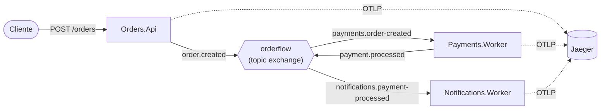

# OrderFlow

Um sistema de pedidos orientado a eventos em .NET 8 em que **uma requisição HTTP gera um único trace distribuído** que atravessa três serviços por meio do RabbitMQ, visualizado no Jaeger.

## Arquitetura



## Serviços

| Projeto | SDK | Papel |
|---|---|---|
| `Orders.Api` | Web | `POST /orders` valida a entrada e publica `order.created`; responde `202` com `orderId` e `traceId`. `GET /health`. |
| `Payments.Worker` | Worker | Consome `order.created`, simula uma cobrança (200-600 ms, aprovada se amount <= 5000) e publica `payment.processed`. |
| `Notifications.Worker` | Worker | Consome `payment.processed` e simula o envio de um e-mail (150 ms). |
| `OrderFlow.Shared` | Biblioteca | Contratos, configuração de telemetria, conexão com o RabbitMQ, publisher e classe base de consumer. |

## O que este projeto demonstra

- Propagação do W3C Trace Context (`traceparent`) pelos headers das mensagens do RabbitMQ.
- Spans de Producer/Consumer ligados como pai e filho entre fronteiras de processo.
- Um `RabbitMqConsumer<T>` reutilizável, com ack manual, nack sem requeue em caso de falha e registro da exceção no span.
- Um publisher thread-safe (`IModel` não é thread-safe) com mensagens duráveis e persistentes.
- Spans de negócio customizados (`charge customer`, `send notification`) com tags de domínio.
- Tratamento de particularidades do RabbitMQ.Client 6.x: os headers chegam como `byte[]` e precisam ser decodificados como UTF-8.

## Como rodar

Pré-requisitos: .NET 8 SDK e Docker.

```bash
docker compose up -d

dotnet run --project src/Orders.Api
dotnet run --project src/Payments.Worker
dotnet run --project src/Notifications.Worker
```

Execute cada `dotnet run` em um terminal separado. A Orders.Api escuta na URL exibida na inicialização (ajuste a porta abaixo de acordo, ou defina `ASPNETCORE_URLS=http://localhost:5000`).

```bash
curl -X POST http://localhost:5000/orders \
  -H "Content-Type: application/json" \
  -d '{"customer":"alice","amount":1200}'
# {"orderId":"...","traceId":"67552c84fd2117faa8fa311bc422d6be"}

curl -X POST http://localhost:5000/orders \
  -H "Content-Type: application/json" \
  -d '{"customer":"bob","amount":9000}'   # o pagamento será recusado
```

## Visualizando o trace

Abra <http://localhost:16686/trace/{traceId}> (ou busque pelo serviço `orders-api` na interface do Jaeger). O painel de gerenciamento do RabbitMQ fica em <http://localhost:15672> (guest/guest).

Cada pedido gera um único trace com 7 spans:

| # | Serviço | Span | Tipo |
|---|---|---|---|
| 1 | orders-api | `POST /orders` | Server |
| 2 | orders-api | `order.created publish` | Producer |
| 3 | payments-worker | `order.created process` | Consumer |
| 4 | payments-worker | `charge customer` | Internal |
| 5 | payments-worker | `payment.processed publish` | Producer |
| 6 | notifications-worker | `payment.processed process` | Consumer |
| 7 | notifications-worker | `send notification` | Internal |

## Configuração

| Variável | Padrão | Usada por |
|---|---|---|
| `RABBITMQ_HOST` | `localhost` | Todos os serviços |
| `OTEL_EXPORTER_OTLP_ENDPOINT` | `http://localhost:4317` | Todos os serviços (lida pelo exporter OTLP) |
| `ASPNETCORE_URLS` | Padrão do ASP.NET Core | Orders.Api |

## Decisões de design e trade-offs

- **API síncrona do RabbitMQ com `DispatchConsumersAsync = true`**: simples e explícita; handlers assíncronos são suportados sem o cliente async da versão 7.x.
- **Um único canal por publisher protegido por lock**: correto e simples, mas serializa as publicações. Adequado para esta escala; um pool de canais seria o próximo passo.
- **Falha rápida na inicialização da API**: o publisher é resolvido logo no startup, com até 10 tentativas de conexão (2 s entre elas).
- **Os consumers chamam `Task.Yield()` primeiro**, para que um broker lento nunca bloqueie a inicialização do host.
- **`nack` com `requeue = false`** evita loops de mensagens venenosas, mas, sem uma dead-letter exchange, as mensagens com falha são descartadas.
- **Publicar dentro do span `charge customer`** mantém todo o fluxo em um único trace.
- **O código de mensageria compartilhado fica no namespace `OrderFlow.Shared.Messaging`** (pasta `RabbitMq`), para evitar conflito entre um namespace `RabbitMq` e a classe `RabbitMq`.
- **O exporter OTLP 1.9.0 está fixado** conforme exigido; o NuGet reporta o advisory GHSA-4625-4j76-fww9 para ele, suprimido em `src/Directory.Build.props` para esta demonstração. Atualize o pacote antes de qualquer uso real.
- Sem banco de dados, autenticação ou frameworks extras, para manter o foco no tracing.

## Próximos passos

- [ ] Dead-letter exchange e política de retry
- [ ] Outbox pattern para publicação confiável
- [ ] Métricas e correlação de logs (trace id nos logs)
- [ ] Consumidores idempotentes
- [ ] Dockerfiles para os serviços
- [ ] Testes de integração com Testcontainers
